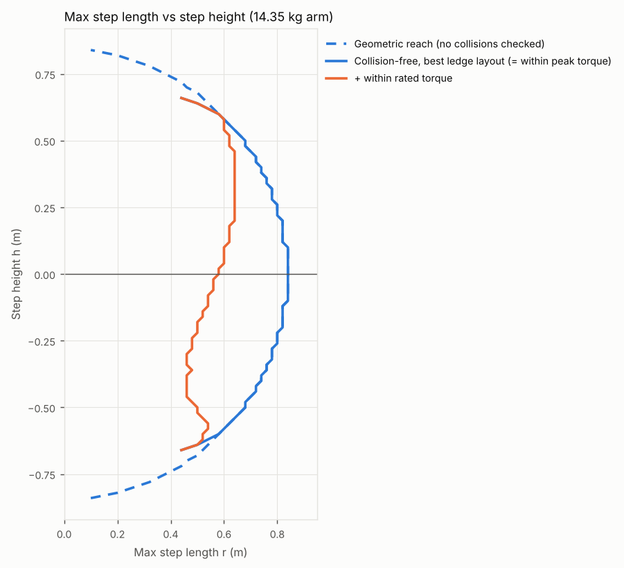
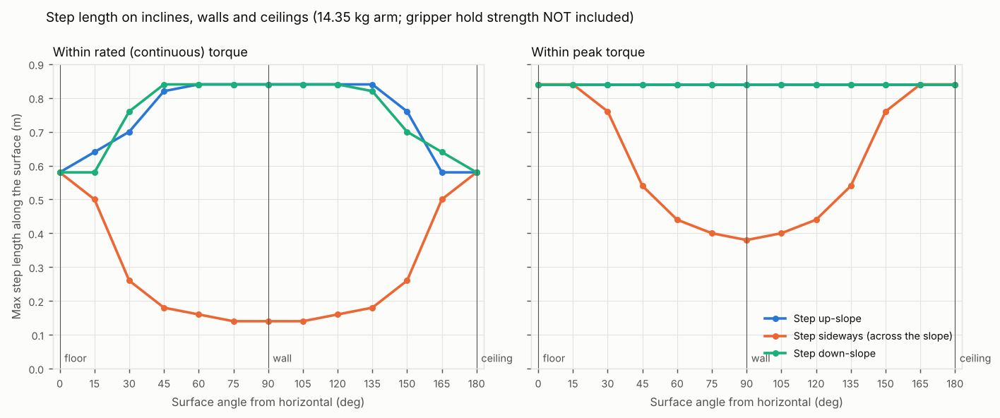
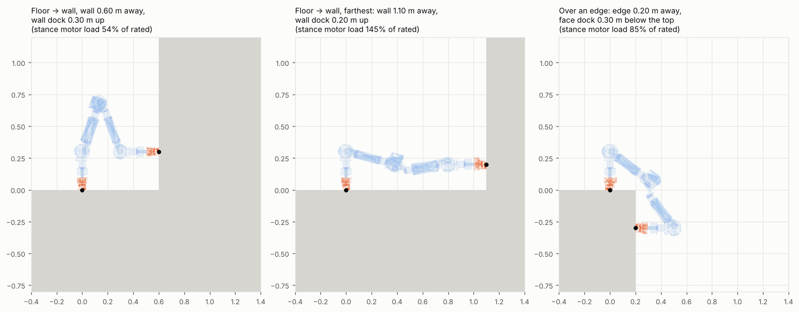

# Step reach and locomotion limits of the Tether arm (sim, 2026-10-28)

Written by John's AI agent. Not authoritative. Everything here is **[assumed]**: it comes from the CAD-exported
URDF, motor datasheets and a few weighed parts, and nothing is measured on hardware. Figures and videos are in
[2026-10-28-john-step-reach-sim/](2026-10-28-john-step-reach-sim/). Code:
[cove-controls `scripts/step_reach_sim/`](https://github.com/TerralabsCove/cove-controls/tree/main/scripts/step_reach_sim).

Re-run on 2026-10-31 with the corrected URDF masses: **the arm is 14.35 kg**. The first run (2026-10-28) used
19.8 kg; reach and step height are the same, and loads are about 28% lower.

## Bottom line

1. **Max step on flat ground is 0.84 m** between dock centres. In practice about 0.80 m, because at full
   stretch the arm cannot lift the gripper straight out of its dock. The limit is geometric: both grippers
   must face the surface, so each end's last 0.30 m stays perpendicular to it and only the two middle
   links make the step.
2. **Max step height is ±0.66 m** (at 0.26–0.44 m forward). It is set by the end pitch joints, whose
   brackets collide at about ±125°.
3. **Peak torque never limits a step on a floor. Rated torque does.** Within rated torque the flat step
   is 0.58 m. The stance-side 10010 pitch needs about 59 Nm at the 0.84 m step (40 rated, 150 peak).
4. **Climbing straight up a wall is easier for the motors than walking on a floor**: full 0.84 m steps at
   about 12% of rated torque.
5. **Moving sideways on a wall or steep slope is limited by the gripper-spin motor** (4340, 27 Nm peak):
   0.38 m max on a vertical wall, and 0.14 m within rated torque.
6. **The real limit on walls and ceilings is probably the gripper and dock.** They must hold the whole
   arm, 141 N, as pull-out (ceiling) or shear (wall), and up to about 95 Nm bending during transitions.
   Gripper capacity is unknown.
7. **Swinging is harder than standing.** Mid-swing, the 4340 roll motors go over their 9 Nm rated torque
   (10–13 Nm) even on 0.44 m floor steps, though they stay well under the 27 Nm peak.

## Setup

| Item | Value | Tag |
|---|---|---|
| Model | cove-controls `src/terra_arm_description/urdf/arm.urdf` v0.2.0 (5 arm motors + 2 gripper-spin motors), masses corrected 2026-10-31 | assumed |
| Foothold | Female dock frame from `dock_female.urdf`. The robot only steps between mounted docks. | assumed |
| Constraint | Both grippers on the dock axis, normal to the surface | assumed |
| Joint ranges | Mesh self-collision only. End pitch about ±125°, middle pitch about ±167°. No cable limits. | assumed |
| DM-J10010-2EC | 40 Nm rated, 150 Nm peak, 1.485 kg (user manual). Rated 48 V; at 24 V torque is unchanged, speed about half. | assumed |
| DM-J4340P-2EC | 9 Nm rated, 27 Nm peak, 0.375 kg (user manual, 24 V) | assumed |
| Torque | Static gravity torque, swing gripper unsupported. No dynamics. | assumed |
| Lift-out | 12 cm along the dock axis before each swing (CAD fin-ray fingers stick out 8 cm past the dock frame) | assumed |

### Masses

The original Fusion export used default materials, so several parts came out as solid steel. The URDF in
cove-controls is now corrected (`scripts/step_reach_sim/apply_measured_masses.py`), and all results below use it.

| Part, each | Original URDF | Corrected URDF | Source |
|---|---|---|---|
| DM-J10010 (×3) | 3.92 kg | 1.485 kg | Datasheet |
| DM-J4340P (×4) | 0.387 kg | 0.375 kg | Datasheet |
| LiPo 3200 mAh (×2) | 0.758 kg | 0.218 kg | Weighed |
| LiPo 5000 mAh (×2) | 0.677 kg | 0.689 kg | Weighed (1.52 lb) |
| Slip ring + base plate (×2) | 2.106 kg | 0.374 kg | Ring weighed (10.5 oz); plate aluminium |
| Slip-ring rotating pin (×2) | 0.135 kg | 0.115 kg | Aluminium |
| Gripper (×2) | 1.362 kg | 0.912 kg | Aluminium housing, TPU jaws and fingers, steel pins, servos weighed (3.52 oz each) |
| **Arm total** | **27.17 kg** | **14.35 kg (31.6 lb)** | |

Masses are **[as built]** for the weighed parts and **[assumed]** for the rest. Wiring, ESP boards, DC-DC
converters, connectors and fasteners are not in the CAD; a rough guess puts the real arm at 15–16 kg, which
would raise every load and torque below by 5–10%.

The battery layout is from the 5-module design and still needs rework for 3 modules (D-004, open questions).

## Results

### Step length vs step height (flat or ledge)

| Step height h (m) | +0.66 | +0.5 | +0.3 | +0.2 | 0 | −0.2 | −0.4 | −0.6 | −0.66 |
|---|---|---|---|---|---|---|---|---|---|
| Max step, collision-free (m) | 0.44 | 0.68 | 0.78 | 0.82 | 0.84 | 0.82 | 0.74 | 0.58 | 0.44 |
| Max step, within rated torque (m) | 0.44 | 0.62 | 0.64 | 0.64 | 0.58 | 0.48–0.50 | 0.46–0.48 | 0.52–0.54 | 0.44 |

Peak torque does not cut into the collision-free envelope anywhere. The two ends (A anchored or B anchored)
agree within 2 cm; where they differ the table gives both. The full map, including where the ledge edge sits,
is in [fig1_foothold_map.png](2026-10-28-john-step-reach-sim/fig1_foothold_map.png). Extreme poses are in
[fig3_poses.png](2026-10-28-john-step-reach-sim/fig3_poses.png).

### Inclines, walls, ceilings

| Surface | Up or down the slope, rated / peak (m) | Sideways, rated / peak (m) | Anchored gripper load |
|---|---|---|---|
| Floor | 0.58 / 0.84 | 0.58 / 0.84 | 141 N pressing in, up to 59 Nm bending |
| 30° | 0.70–0.76 / 0.84 | 0.26 / 0.76 | 122 N in, 70 N shear |
| 45° | 0.82–0.84 / 0.84 | 0.18 / 0.54 | 100 N in, 100 N shear |
| Wall | 0.84 / 0.84 | 0.14 / 0.38 | 141 N shear, about 38 Nm bending |
| Ceiling | 0.58 / 0.84 | 0.58 / 0.84 | **141 N pull-out**, up to 59 Nm bending |

0.12 m is the shortest step tested.

### Surface transitions

- **Floor to wall (inside corner):** works with the stance dock 0.40–1.14 m from the wall and the wall dock
  0.06–0.6 m up. With the wall dock 0.3 m up, stay 0.40–0.84 m from the wall to keep within rated torque.
- **Over an edge (outside corner, e.g. cresting a wall):** the hardest move. The top dock must be within
  0.36 m of the edge and the face dock within 0.36 m below it (static); within rated torque, within 0.28 m of
  the edge. With the 12 cm lift-out, the face dock needs to be about 0.2 m below the edge.

### Dock placement rules that follow

- Floor docks ≤0.58 m apart for continuous walking within rated torque (0.80 m hard limit).
- Wall docks in a vertical line, up to 0.8 m apart. Avoid sideways rows.
- First wall dock about 0.3 m up, 0.40–0.84 m from the last floor dock.
- Over an edge: top dock about 0.2 m from the edge, face dock about 0.2 m below it.

## Videos

Dock-to-dock steps planned with collision checks and rendered with the live torque of all seven motors and
the anchored-gripper load. Quasi-static.

| Video | Highest motor load along the path | Anchored gripper, worst |
|---|---|---|
| [01 floor, 0.44 m steps](2026-10-28-john-step-reach-sim/01_floor_rated_0.44m.mp4) | A roll 10 Nm (over rated, under peak) | 32 Nm bending |
| [02 floor, 0.80 m steps](2026-10-28-john-step-reach-sim/02_floor_near_max_0.80m.mp4) | A pitch 57 Nm, B roll 13 Nm | 57 Nm bending |
| [03 up and over a 0.5 m box](2026-10-28-john-step-reach-sim/03_box_up_and_over_0.5m.mp4) | A roll 12 Nm, A pitch 41 Nm | 41 Nm bending |
| [04 30° incline, up](2026-10-28-john-step-reach-sim/04_incline_30deg_up.mp4) | B roll 13 Nm, gripper spin 11 Nm | 70 N shear, 57 Nm bending, 11 Nm twist |
| [05 floor to wall, then climb](2026-10-28-john-step-reach-sim/05_floor_to_wall_climb.mp4) | A pitch 55 Nm (under 150 peak) | 141 N shear, 95 Nm bending |
| [06 wall, sideways](2026-10-28-john-step-reach-sim/06_wall_sideways.mp4) | Gripper spin 36 Nm in the 0.5 m step: **over the 27 Nm peak, would fail** | 36 Nm twist, 65 Nm bending |
| [07 over the top of a 1.5 m wall](2026-10-28-john-step-reach-sim/07_crest_wall_top.mp4) | B pitch 59 Nm, gripper spin 11 Nm | 141 N shear, 95 Nm bending |
| [08 ceiling, 0.44 m steps](2026-10-28-john-step-reach-sim/08_ceiling_0.44m.mp4) | A roll 10 Nm | 141 N pull-out, 32 Nm bending |

Every 10010 pitch stays under 60 Nm (40 rated, 150 peak); the ones over rated are only briefly, mid-swing or
at the longest steps. The planner rejects paths over peak in video 07. It does not yet minimise torque, so
the roll-motor overloads may be avoidable. Videos 01 and 08 keep the 0.44 m steps from the first run, now
well inside the 0.58 m rated limit.

## Conflicts and open items

- **Sim model source.** [truth/robot.md](../truth/robot.md) lists `full_assembly/urdf/simple_assembly.urdf`
  (Cove) as the sim model for the COVE2 sim. This work used `terra_arm_description/urdf/arm.urdf` (the new
  Tether arm), also listed there. Not resolved here.
- **Which 10010? Resolved 2026-10-31:** the motor is the plain DM-J10010-2EC (40 Nm rated, 150 Nm peak,
  1.485 kg). The URDF link names still say `DM-J10010L-2EC`; they were left as they are because MoveIt
  configs and sim code refer to them.
- **Gripper capacity** in pull-out, shear, bending and twist is unknown.
- **Lift-out distance** needed to clear a dock is unknown (12 cm assumed).

## Suggested next steps

1. Bench-test the gripper in a dock: pull-out, bending and twist. Static worst cases are about 141 N,
   95 Nm and 27 Nm (the spin motor's peak); add margin for swing dynamics and unmodelled mass.
2. Decide on the gripper-spin axis for wall work: brake, stronger motor, or no sideways wall moves.
3. Hardware test order: flat 0.3–0.58 m steps, 0.3 m step up, 30° incline straight up. Walls only after
   the gripper test.
4. Weigh the assembled arm to replace the remaining CAD masses.
5. Sim: torque-minimising swing paths, then dynamics at 24 V (step time, speed, battery current).
