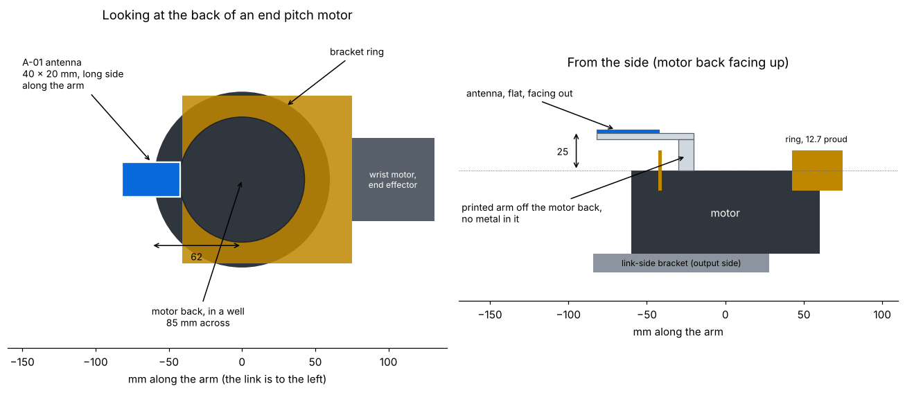
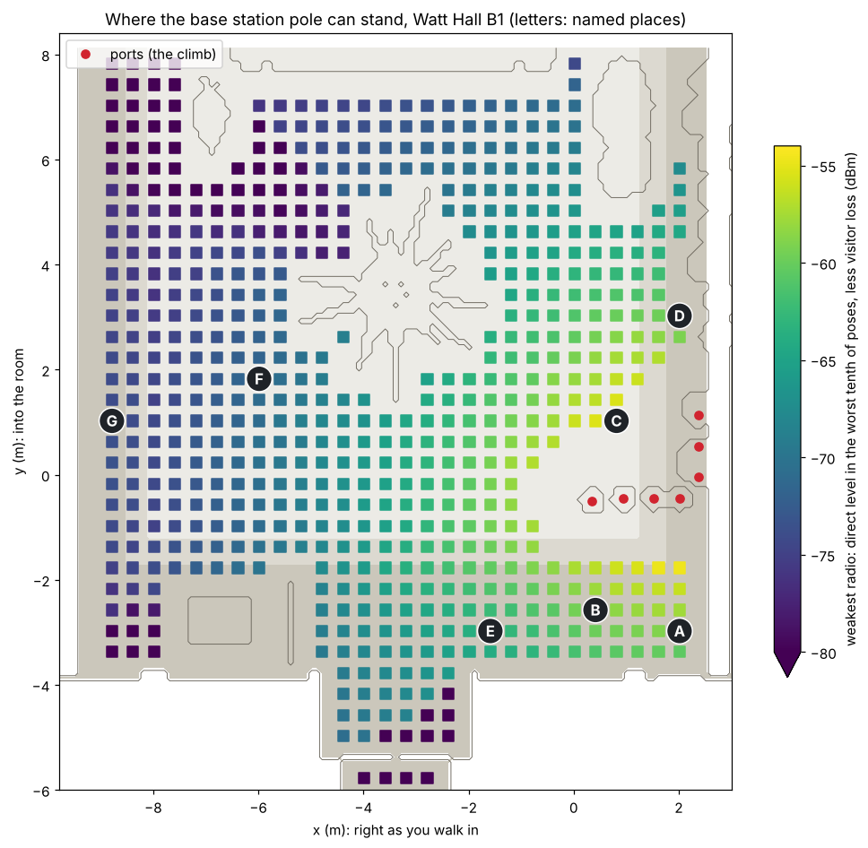

# Antenna placement on the arm and the base station's place in Watt Hall B1 (2026-11-23)

Written by John's AI agent on 2026-11-23. Not authoritative. **Calculated in the simulator, not measured.**
Summary only. The method, the full tables and the code are in tethersim,
[docs/RF.md](https://github.com/TerralabsCove/tethersim/blob/claude/serene-maxwell-6z2xa1/docs/RF.md)
(branch `claude/serene-maxwell-6z2xa1`, not merged). It follows the
[antenna and RF plan](2026-10-19-john-esp32c5-antenna-rf-plan.md) and uses the
[C5 range test](2026-10-28-hansi-c5-range-test.md) for its one calibration number.

## The question

John asked where each XIAO ESP32-C5's Seeed A-01 antenna should go on the robot, how it should be
oriented on the back of the motor, and where in the room the base station (the master C5) should be. His
answers to the scoping questions:

- Five radios on the robot: the three modules (D-020) and the two end effectors (D-048).
- A printed standoff is fine.
- The base station is on a pole no taller than 2 m, wired to the laptop. Where the operator sits follows
  from where the pole goes.
- The shell is not decided, so the result is a rule for it.

## Answer [assumed: calculated]

| Radio | Where | Antenna's long (40 mm) side |
|---|---|---|
| Side modules (the end pitch motors) | On a printed arm off the motor's back. The antenna sits outside the bracket ring and 25 mm proud of the back face, inboard of the motor (toward the link). | Along the arm, parallel to that end's docking axis. Flat face parallel to the motor back. |
| Centre module | On a printed tab off an edge of the battery box, level with the cover. The closed end of the cover is the pick. | In the plane of the cover, on the box's diagonal. |
| End effectors | 20 to 30 mm off the side of the body, clear of the port. Just beyond the camera is best. | Parallel to the docking axis. |
| Base station | Front-right corner of the walkway, 2.5 to 4 m from every port. Antenna 1.5 to 2 m up the pole. | Upright, or its top leaned 20 to 30° toward the set. Never level. |

What each choice is worth, in the signal of the worst tenth of arm poses:

- Orientation: 8 to 10 dB. All five antennas end up parallel to a docking axis, so they stand upright
  whenever their end is planted. The base antenna matches them.
- Getting the antenna past the edge of the metal: 4 to 6 dB. In the middle of the motor back it cannot
  see the half of the room behind the motor.
- Base position: about 5 dB across the front-right quarter of the room. The far side is 8 to 13 dB
  lower, and 7 to 33 dB more once visitors stand in the way.

With these mounts and the base in the front-right corner, the weakest radio's direct signal is −56 dBm
in the median pose and −70 dBm in the worst. The C5's limit is −92.5 dBm, and the 10-28 test saw clean
delivery down to about −67 dBm.

Letters: A front-right corner (the pick), B front walkway opposite the pit ports, C pit floor behind
the build area, D right walkway past the tall table, E beside the entrance, F and G the far side.
C scores 5 dB better than A and stands where visitors would. A is a dead end, because the tables fill
the right walkway.

## Shell rule

Nothing conductive over an antenna or within 15 mm of it: no foil, metallic paint, carbon fibre, wire
mesh, or LED strips and their wiring. Printed PLA or PETG up to 3 mm, or dry fabric, is fine. Leave a
few millimetres of air between the shell and the antenna's face.

## What this rests on [assumed]

- The arm's CAD and the `watthall_real_steps` scene: 371 poses (the six-step climb and random reaches).
- The A-01 as a simple dipole along its long side. Seeed's A-01 datasheet (below) shows that shape, with
  nulls 10 to 15 dB deep. It does not show how its axes sit on the strip.
- One calibration: the best radio's 3 m reading on 10-28 (−47 to −50 dBm, 10 dB under the ideal).
- 0.3 visitors per m², 8 dB for each one in the path.
- Reflections off the walls are left out of the ranking. They add signal, and it fades as the arm moves.
- Detuning by metal closer than 10 mm, interference, and channel sharing are not modelled.

## From the A-01 datasheet (added 2026-11-23)

John supplied Seeed's datasheet for the A-01 (part M01-0601770R0A) after the sweep. Its numbers are now
in the model. The answer above did not change.

- **Channel 36 is the antenna's weakest 5 GHz channel.** Efficiency is 44.5 % at 5180 MHz, 52 % at 5240
  and 60 to 67 % at 5740 to 5820. A link on channel 149 to 165 should be 1.5 to 2.6 dB stronger than on
  channel 36, and channel 48 is 1.3 dB stronger. [assumed: from the datasheet, not measured on the arm]
  This adds to open question 14, which already asks 149–165 against 36–48.
- Peak gain is 1.86 dBi at 5180 MHz. The 2.8 dBi on the product page is the peak at 5420 MHz.
- One polarisation dominates by roughly 10 dB at 5100 and 5500 MHz and less at 5900 MHz, so turning an
  antenna the wrong way should cost a little less at the top of the band.
- The feed pads sit side by side along the 40 mm side. That fits the long side being the polarisation
  axis. The 90° turn test below still decides it.

## Things found on the way

- On the two side modules, the motor back is on the wrist side of the pitch joint (the housing, the
  bracket ring and the wrist motor are one piece in the CAD). The A-01's lead is 80 mm. If the C5 sits
  on the link side (D-033 says "on the big motor side"), the lead would have to cross the joint.
  **Open: which side of the joint is the C5 on?**
- The centre motor's back is under the battery box, so that module's antenna goes on the box.
- The antennas are the dual-band A-01 (John, 2026-11-23). The 2.4 GHz-only A-02 has nearly the same
  outline and has "2.4G A-02" printed on it. So a wrong antenna does not explain 0x04's weak signal on
  10-28, and that cause is still open.

## Checks that would make this [verified]

1. Two boards 2 m apart: turning one strip 90° in its own plane should cost about 10 dB.
2. One side module: antenna 15 mm off the centre of the motor back against the rim arm, joint swung
   through its range, RSSI at the gateway (tethersmall `link_check.py --listen 30`).
3. The pole at A to E with the arm on `pit_build` and on `tall_bridge`, with and without two people in
   the way.

Target: −65 dBm or better at the gateway in every pose.

## Not changed

Nothing in `truth/` was edited. [robot.md](../truth/robot.md) still lists antenna type and mounting as
open, and open questions 14 and 15 stand.
